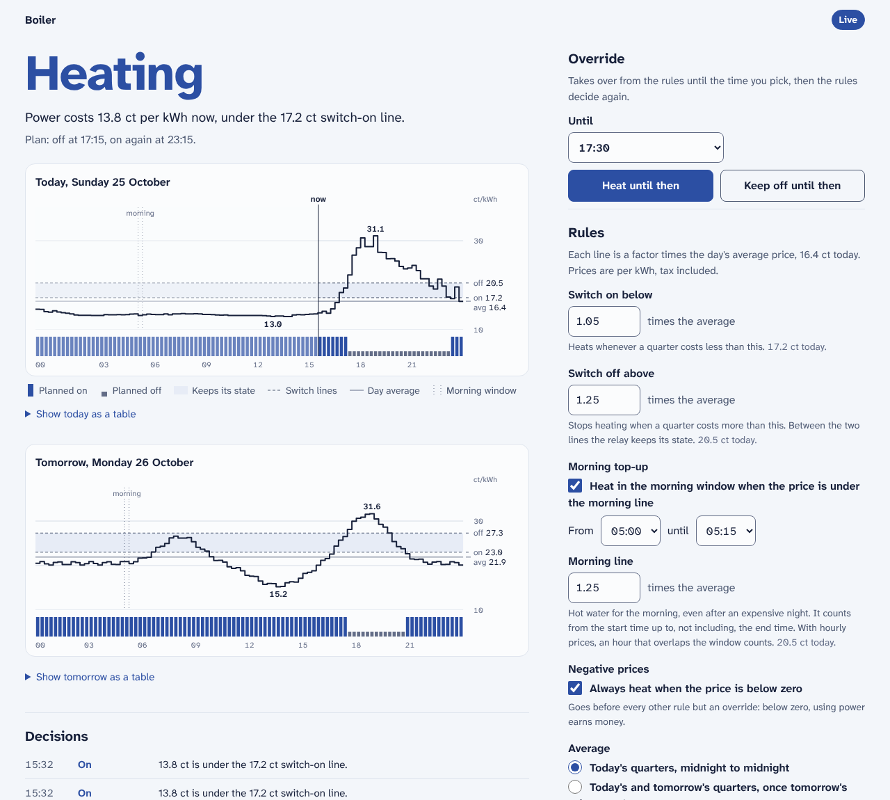

# shelly-control

A small service that switches a **Shelly Gen2 relay** by the electricity price,
with a web page to set the rules and see what it does. It reads the
quarter-hour prices a [tibber-exporter](https://github.com/Yornik/tibber-exporter)
already serves in the same cluster, decides every quarter hour with rules you
set on the page, and turns the relay on or off with `Switch.Set`. It was built
to replace a cron script that switched an electric water boiler (about 1.1 kW)
through a Shelly Plus 1PM, and it starts the way that script worked.

> [!WARNING]
> **There is no login.** Whoever can open the page can change the rules and
> switch a 1.1 kW boiler. Run it only where the network is the gate, such as a
> Tailscale tailnet, and never expose it to the internet. `SHELLY_PASSWORD` is
> the device's admin password: with it, any software can switch the relay,
> change every setting and install firmware. Keep it in an encrypted secret.
> The Plus 1PM stays on firmware 1.7.x, which serves HTTP only.

> [!IMPORTANT]
> **Unofficial project.** This isn't made, endorsed or supported by Shelly
> Group SE or by Tibber. **Shelly** and **Tibber** and their logos are
> trademarks of their owners. See [Disclaimer & trademarks](#disclaimer--trademarks).

<picture>
  <source media="(prefers-color-scheme: dark)" srcset="docs/ui-dark.png">
  
</picture>

_Rendered against a fake relay and a fake exporter serving the real prices of
25 October 2026 (the 25-hour day summer time ends) and made-up prices for the
day after._

- **Switches with `Switch.Set` only, enforced.** The device client can call
  three methods: two reads and `Switch.Set`. It refuses anything else before a
  byte is sent, checks every request again as it leaves, and a CI job fails if
  more appears anywhere in the code.
- **Uses the prices the cluster already has.** It asks the tibber-exporter, not
  Tibber. There is no Tibber token in this service.
- **Shadow mode first.** By default it decides and logs every quarter hour but
  never switches, so you can compare it with the old controller before it
  takes over. Switching also needs `ALLOW_SWITCHING=true` in the deployment.
- **Fails safe.** Without a usable price the rules switch nothing, and the page
  says why; only an override, which needs no price, still switches. A device
  that can't be read is retried, not guessed at. A full or read-only volume
  never stops a decision.

## What it can do to the device, and how that's enforced

Three layers, each one you can check in a few minutes:

1. **Little code that can switch.** The device client
   ([`shelly.py`](shelly_control/shelly.py)) knows three RPC methods:
   `Shelly.GetDeviceInfo`, `Switch.GetStatus` and `Switch.Set`. Every request
   is an HTTP `GET` to `/rpc/<method>`, with only `id` and `on` as parameters.
   Only one function calls `set_output`: `Controller._apply`, which sends
   `Switch.Set` only in live mode or for an override, only when the relay is
   not already where the decision wants it, never on a rule's decision without
   a usable price (an override needs none), and never twice within
   `MIN_SWITCH_INTERVAL_SECONDS`.
2. **Runtime checks, twice.** `ShellyClient._call` raises `AllowlistViolation`
   before anything is sent if the method isn't in `ALLOWED_METHODS`, or a
   parameter isn't allowed or has the wrong type. Then the HTTP session checks
   each request again as it is sent: a `GET` of `/rpc/<allowlisted method>` on
   the configured host, with exactly that method's parameters (`id` a small
   number, `on` `true` or `false`). That second check also covers the request
   that answers a digest challenge. The price client has the same two checks:
   only `GET /homes/<id>/prices`, no query, on the configured exporter. A
   violation stops the process instead of being retried.
3. **CI guard.** The `Allowlist guard` job runs
   [`scripts/check_allowlist.py`](scripts/check_allowlist.py). It reads the
   code's syntax tree, not its comments, and fails if:
   - the allowlist differs from the copy pinned in the script, or anything but
     `Switch.Set` writes;
   - any string looks like an RPC method or a path that isn't allowed, or names
     another write method (`Toggle`, `Reboot`, `SetConfig`, …), a Gen1 control
     path (`/relay/0?turn=on`), firmware, scripts, webhooks, `toggle_after`, or
     the Tibber API (`api.tibber.com`, `graphql`, a bearer token);
   - there is any HTTP call besides one `self.session.get(..., allow_redirects=False)`
     in each client, or `requests` is imported anywhere else;
   - `set_output` is called anywhere but `Controller._apply`, or anything but the
     controller imports the device client;
   - `getattr`, `eval`, `exec`, `importlib` or `__doc__` could hide a call;
   - a template uses `|safe`, an inline script, style or event handler, or an
     outside URL, or a form posts anywhere but a known route.

   Tests prove the guard catches each of these, and that the clients refuse
   them without sending anything.

## The rules

Every quarter hour, a few seconds after it starts, the first rule that applies
decides:

| # | Rule | Default | The live script (`boiler2.sh`) |
|---|---|---|---|
| 1 | **Override**: on or off until a time you pick, then back to the rules | none | (none) |
| 2 | **No usable price**: no price for this quarter, or not all of today's prices | always | no current price: exits without acting |
| 3 | **Negative prices**: below zero, heat | on | `price < 0 → on` |
| 4 | **Morning top-up**: inside the window and under the morning line, heat | on, the 05:00 quarter (05:00 to 05:15), line 1.25 × average | `05:00 and price < 1.25 × average → on` |
| 5 | **Switch-on line**: under it, heat | 1.05 × average | `price < 1.05 × average → on` |
| 6 | **Switch-off line**: over it, stop heating | 1.25 × average | `price > 1.25 × average → off` |
| 7 | **Between the lines**: the relay keeps its state, nothing is sent | | no action |

In plain words: a quarter that costs less than the switch-on line heats, a
quarter that costs more than the switch-off line doesn't, and in between the
boiler carries on doing what it was doing. The comparisons are strict, as in
the script: a price exactly on a line keeps the state. A line is a factor
times the day's **average**: by default the mean of today's quarters, from
local midnight to midnight (92, 96 or 100 of them, depending on summer time).
The page can also average today's and tomorrow's quarters once tomorrow's
prices are known (`day_and_next`; the default is `day`). Prices are Tibber's
`total`: energy plus tax, per kWh.

The average and the lines are worked out in decimal and rounded to three
decimals (0.1 ct, as the page shows them), so a price the exporter writes as
`0.21` is exactly on a `0.210` line and keeps the state. The script's `bc -l`
keeps 20 decimals; a line here is at most 0.05 ct from the script's.
Factors take at most two decimals.

The morning window counts a quarter that starts inside it (from the start time
up to, not including, the end time). The default is the 05:00 quarter only:
the script runs every quarter and checks for 05:00 exactly. With the
exporter's hourly fallback prices, an hour that overlaps the window counts, so
the default window then covers 05:00 to 06:00.

**Why 1.05 and 1.25?** They are the live script's factors (`boiler2.sh`, run
by cron). An older published copy of the script says 1.20
and 1.50 with hourly prices, and the relay's own log rules those out.
Replaying five days of real prices (20 to 24 October 2026) with the rules
above, switch-on factors from 1.03 to 1.05 with switch-off factors from 1.24
to 1.28 reproduce all five logged switches at the exact quarter. The boiler's
power readings narrow the switch-off factor to 1.24 to 1.26: they show it
starting at 21:45 on 20 October after hours cold, a switch-on that needs a
switch-off earlier that evening, which 1.27 and up never make. 1.20 and 1.50
reproduce none of the five. The replay is a test:
[`tests/test_rules.py`](tests/test_rules.py) runs it on
[`tests/fixtures/replay_2026-10-20_to_24.json`](tests/fixtures/replay_2026-10-20_to_24.json)
(prices only), and checks these ranges.

**Shadow and live.** In shadow mode the service makes the same decisions and
logs them, but sends nothing; "keep" then keeps the state this service *would*
have set. An override switches the relay in both modes. When an override ends
in shadow mode, nothing switches the relay back: it stays as the override left
it until the old controller, or live mode, switches it. Going live on the page
or through the API needs a tick in a confirmation box (`"confirm_live": true`),
and `ALLOW_SWITCHING=true`. `DEFAULT_MODE=live` in the deployment starts the
service live without that confirmation, so set it only on purpose.

**Summer time.** A slot is found by its start time, never by its position in
the list, so the 25-hour day (02:00 to 02:45 twice) and the 23-hour day work.
The old script read `today[hour]` and was an hour off after the repeated hour.

## The web interface

One page, top to bottom on a phone, in two columns from 960 px:

- **State**: the relay in one word (Heating, On, Off), the decision in one
  sentence ("Power costs 13.0 ct per kWh now, under the 17.2 ct switch-on
  line."), and the next planned changes.
- **Today and tomorrow**: the price per quarter in ct/kWh with the switch lines,
  the band between them where the relay keeps its state, the day's average,
  the morning window, and a rail of quarter-hour pins with the plan (a full
  pin on, a short bar off, a dotted baseline where there is no plan). The x
  axis is the clock: a quarter without a price is a hatched gap, not a line
  that runs on. Hover, tap or focus the chart and use the arrow keys for one
  quarter's details; every value is also in the table under each chart.
- **Override**: heat or keep off until a time, or end it early. The times on
  offer are full times, so a choice that passes while the page stands open
  is refused, never moved to the same time tomorrow.
- **Rules**: every setting above, with what it means today in cents.
- **Decisions**: the last 48 decisions and changes, newest first, with who made
  a change if the Tailscale proxy says so.
- **Status**: how fresh the prices and the relay reading are.

The page works without JavaScript; the script only adds the chart readout,
moves to a refused form's errors, and reloads a page left open for five
minutes, but not while you use it (a form being filled in, a table or the
explanation opened, the chart in focus). It loads nothing from outside: the
font ([Atkinson Hyperlegible Next](shelly_control/static/fonts/OFL.txt)) is in
the image.

### The JSON API

| Method and path | Does |
|---|---|
| `GET /api/v1/status` | Mode, the latest decision with all its inputs, the relay, the override, price health, the settings, and `csrf_token` |
| `GET /api/v1/plan?day=today\|tomorrow` | The plan for every quarter of the day, with price, rule and reason |
| `GET /api/v1/settings` | The settings |
| `PUT /api/v1/settings` | Change some settings (names as `GET` returns them; `mode` is `shadow` or `live`, `average_window` is `day` or `day_and_next`). Add `"confirm_live": true` to go live. `422` with `errors` by field |
| `POST /api/v1/override` | `{"action": "on" \| "off", "until": "18:00" or an ISO time}`, at most 24 hours |
| `DELETE /api/v1/override` | End the override |
| `GET /api/v1/decisions?limit=100` | The decision log, newest first |

Changes need `Content-Type: application/json` and the token from
`/api/v1/status` in an `X-CSRF-Token` header:

```bash
host=https://boiler.your-tailnet.ts.net
token=$(curl -s $host/api/v1/status | jq -r .csrf_token)
curl -s -X PUT -H 'Content-Type: application/json' -H "X-CSRF-Token: $token" \
  -d '{"on_factor": 1.1}' $host/api/v1/settings
```

### What protects it, without a login

The tailnet is the gate. On top of that, because a browser on the tailnet also
visits other sites:

- **Host allowlist.** Every page and API call must name a host in
  `ALLOWED_HOSTS`, so a DNS-rebinding page can't use your browser to reach the
  service under its own name. `/metrics`, `/healthz` and `/readyz` are exempt:
  probes and scrapes arrive with the pod's IP. A refused host is logged once.
- **Changes by POST, PUT or DELETE only**, refused when the browser says they
  come from another site (`Sec-Fetch-Site`) or origin (`Origin`).
- **A token on every change.** Forms carry it in a hidden field, the API in a
  header. It is made when the process starts and never stored: no cookie, no
  session, no secret key. After a restart, a form left open says "This form
  expired. Reload the page."
- **No CORS headers**, a Content-Security-Policy without inline script or
  style, templates that escape everything, and a 16 KiB request limit.

`Tailscale-User-Login`, if the proxy sends it, is shown in the log as "by …"
and in Status as "as named by the Tailscale proxy". Anyone who reaches the
service can send that header, so it decides nothing and proves nothing.
`/metrics` skips the Host allowlist, so a DNS-rebinding page could read it: it
holds the settings, the relay state and the override, never a secret.

## Metrics

Prefix `shelly_control_`. The device's own readings (power, energy, voltage,
temperature) are not here: [shelly-bridge](https://github.com/Yornik/shelly-bridge)
exports those.

| Metric | Labels | Description |
| --- | --- | --- |
| `shelly_control_live` | | `1` in live mode, `0` in shadow mode |
| `shelly_control_switching_allowed` | | `1` if `ALLOW_SWITCHING` allows switching at all |
| `shelly_control_decision_action` | `action` | `1` for the latest decision's action (`on`, `off`, `keep`), `0` for the others |
| `shelly_control_decision_rule` | `rule` | `1` for the rule that decided: `override`, `no_prices`, `negative`, `no_lines`, `morning`, `below_on`, `above_off`, `between` |
| `shelly_control_target_on` | | `1` if the decision wants the relay on, `0` off. Absent while unknown. |
| `shelly_control_price_per_kwh` | `kind` | The decision's inputs: `slot` (this quarter's price), `average`, `on_line`, `off_line`, `morning_line` |
| `shelly_control_morning_window` | | `1` if this quarter is inside the enabled morning window |
| `shelly_control_override_active` | | `1` while an override is in force |
| `shelly_control_override_until_timestamp_seconds` | | When the override ends |
| `shelly_control_relay_on` | | The relay as last read |
| `shelly_control_relay_read_success` | | `1` if the last read of the relay worked |
| `shelly_control_relay_last_read_timestamp_seconds` | | Time of the last good read |
| `shelly_control_last_evaluation_timestamp_seconds` | | Time of the last decision |
| `shelly_control_prices_up` | | `1` if the last read from the exporter worked |
| `shelly_control_prices_usable` | | `1` if the prices cover this quarter and all of its day |
| `shelly_control_prices_last_success_timestamp_seconds` | | Time of the last good read from the exporter |
| `shelly_control_prices_known_until_timestamp_seconds` | | When the last known price slot ends |
| `shelly_control_evaluations_total` | | Counter. Decisions made |
| `shelly_control_switch_commands_total` | `target` | Counter. Switch commands the device accepted |
| `shelly_control_switch_failures_total` | `reason` | Counter. Failed switch commands: `timeout`, `connection`, `http`, `auth`, `invalid_response`, `not_confirmed` |
| `shelly_control_relay_read_errors_total` | `reason` | Counter. Failed reads of the relay |
| `shelly_control_price_read_errors_total` | `reason` | Counter. Failed reads from the exporter: `timeout`, `connection`, `http`, `not_served`, `invalid_response` |
| `shelly_control_shadow_disagreements_total` | | Counter. Quarters in shadow mode where the relay still differed from the rules a minute in |
| `shelly_control_state_write_errors_total` | | Counter. Failed writes to the state directory |
| `shelly_control_state_saved` | | `1` if the last write worked |

Every reason label is present from the start, at `0`.

## Configuration

| Variable | Default | Description |
| --- | --- | --- |
| `SHELLY_URL` | _(required)_ | The device, for example `http://192.168.1.25`. Scheme, host and port only. |
| `SHELLY_PASSWORD` | _(none)_ | The device's password, if authentication is on. The user is always `admin`. |
| `SHELLY_SWITCH_ID` | `0` | The switch to control, 0 to 15. `0` on a Plus 1PM. |
| `SHELLY_TIMEOUT_SECONDS` | `5` | Per request to the device (0.5 to 30) |
| `TIBBER_EXPORTER_URL` | `http://tibber-exporter.monitoring.svc:8080` | The exporter. Scheme, host and port only. |
| `TIBBER_HOME_ID` | _(required)_ | The home's id as the exporter serves it, a UUID. Set it in your deployment, not in code. |
| `TIBBER_EXPORTER_TIMEOUT_SECONDS` | `5` | Per request to the exporter (0.5 to 30) |
| `TIMEZONE` | `Europe/Amsterdam` | The home's time zone: what "today" and "05:00" mean |
| `STATE_DIR` | `/data` | Where the settings, the decision log and the last good prices are kept |
| `LISTEN_PORT` | `9123` | The page, the API and `/metrics` |
| `ALLOWED_HOSTS` | `localhost:9123,127.0.0.1:9123` | Comma-separated host names the page answers to, such as `boiler.your-tailnet.ts.net` |
| `ALLOW_SWITCHING` | `false` | Master switch. Without `true` nothing is ever sent to the relay, in any mode. |
| `DISPLAY_NAME` | `Boiler` | The name at the top of the page |
| `PRICE_REFRESH_SECONDS` | `300` | How often the prices are read again between decisions (60 to 3600) |
| `EVALUATION_DELAY_SECONDS` | `5` | How long after each quarter hour the decision is made (0 to 120) |
| `MIN_SWITCH_INTERVAL_SECONDS` | `60` | The relay is never switched twice within this time, measured on a clock no clock step moves (10 to 900) |
| `DECISION_LOG_SIZE` | `700` | Decisions kept, about a week (10 to 5000) |
| `DEFAULT_<SETTING>` | see [the rules](#the-rules) | The default of a setting until someone saves the rules, checked like the page checks it. `DEFAULT_MODE`: `shadow` or `live` (live skips the confirmation). `DEFAULT_ON_FACTOR`, `DEFAULT_OFF_FACTOR`, `DEFAULT_MORNING_FACTOR`: 0.50 to 3.00, two decimals, off at or above on. `DEFAULT_MORNING_START`, `DEFAULT_MORNING_END`: `HH:MM` on the quarter hour, end after start. `DEFAULT_MORNING_ENABLED`, `DEFAULT_NEGATIVE_ENABLED`: `true` or `false`. `DEFAULT_AVERAGE_WINDOW`: `day` or `day_and_next`. |

### What it asks the device

| Method | When | What for |
| --- | --- | --- |
| `Switch.GetStatus` (`id`) | Every decision, and after a switch to confirm it | Whether the relay is on, what last changed it, its power, protection errors |
| `Switch.Set` (`id`, `on`) | Only when the decision differs from the relay, in live mode or for an override | Turn the relay on or off |
| `Shelly.GetDeviceInfo` | Once, at the first good read | Model, firmware, whether authentication is on. Needs no password. |

With authentication on, firmware 1.7.x challenges every request, so each call
is two round trips. After a refused password the service waits 5 minutes
before it tries again. It never sends `toggle_after` or any 2.0 parameter.

### What it asks the tibber-exporter

`GET /homes/<TIBBER_HOME_ID>/prices`, without a `period`: today's prices and,
from about 13:00, tomorrow's. Every 5 minutes and before each quarter's
decision if the last read is older than a minute. The service:

- finds the quarter by its `startsAt` time, so summer-time days work;
- refuses a reply that isn't a JSON list (`null` counts as empty). The exporter
  answers a wrong home id with HTTP 200 and the text "Tibber exporter"; that is
  reported as `not_served`;
- keeps the best version of each day: a whole day over part of one, and
  quarter-hours over the exporter's hourly fallback;
- keeps the last good prices in memory and in `STATE_DIR`, so it decides on
  through an exporter outage as long as the prices cover today. Published
  prices don't change.

### HTTP endpoints

| Path | Answers |
| --- | --- |
| `/` | The page |
| `/api/v1/…` | The JSON API above |
| `/metrics` | The metrics above |
| `/healthz` | `200` while the process runs |
| `/readyz` | `200` if the prices cover this quarter and a decision was made in the last 20 minutes, else `503` with the reason |

### Logs

One JSON object per line on stdout. Each decision is one line with every input
and the outcome:

```json
{"ts": "2026-10-25T12:45:05+00:00", "level": "info", "logger": "shelly-control", "event": "evaluation", "kind": "evaluation", "trigger": "quarter", "slot_start": "2026-10-25T13:45:00+01:00", "price": 0.1296, "average": 0.1637, "on_line": 0.1718, "off_line": 0.2046, "morning_line": 0.2046, "morning": false, "rule": "below_on", "action": "on", "target": true, "mode": "live", "override": null, "outcome": "unchanged", "sent": false, "relay_before": true, "relay_after": true, "reason": "13.0 ct is under the 17.2 ct switch-on line.", "note": "The relay is already on.", "error": null}
```

Other lines have an `event` of `start`, `controller_start`, `stop`,
`device_found`, `device_auth_off` (a warning: authentication is off on the
device), `device_failing`, `device_back`, `prices_changed`, `prices_failing`,
`prices_back`, `change` (settings or override, with `by`), `store_failing`,
`store_back`, `host_refused`, or `bug` (an evaluation failed on an unexpected
error, with the traceback; the next one runs as usual). No line holds the
password or the home id.

### State on disk

Three JSON files in `STATE_DIR`, each written to a temporary file, synced and
renamed over the old one, so a crash leaves the old file or the new one:

- `state.json`: the settings and an active override, with who changed them last;
- `decisions.json`: the decision log;
- `prices.json`: the last good prices.

A missing `state.json` means the defaults. One that can't be read is renamed
`state.json.unreadable-<time>`, and one a newer release wrote
`state.json.newer-<time>`; either way the defaults are used **in shadow
mode**, with a banner. Temporary files a crash left behind
(`.state.json.<random>.tmp` and the like) are removed at the next start. A file without a
`version`, with just settings in it, is read as settings. If writing fails
(a full or read-only volume), the service keeps going with its state in memory,
shows a banner and counts `shelly_control_state_write_errors_total`.

## Getting started

You need a Shelly Gen2 relay, a running tibber-exporter, and Docker, or
Python 3.12+ from source.

> [!NOTE]
> **Before the first release:** `ghcr.io/yornik/shelly-control` only exists
> once release-please has published v1.0.0. Until then, build the image
> yourself: `docker build -t ghcr.io/yornik/shelly-control:latest .`

### 1. Run it in shadow mode

```bash
export SHELLY_PASSWORD='the-device-password'
export TIBBER_HOME_ID='<the home id the exporter serves>'

docker run -d --name shelly-control -p 9123:9123 -v shelly-control:/data \
  -e SHELLY_URL=http://192.168.1.25 -e SHELLY_PASSWORD -e TIBBER_HOME_ID \
  -e TIBBER_EXPORTER_URL=http://tibber-exporter:8080 \
  ghcr.io/yornik/shelly-control:latest
```

From source: `pip install -r requirements.txt`, set the same variables, then
`python -m shelly_control`.

### 2. Check it

Open `http://localhost:9123/`. The page should show the relay's state, today's
prices and a decision. If it says why it can't, the banner names the problem:

| Banner or log says | Fix |
| --- | --- |
| `the exporter does not serve this home` | Wrong `TIBBER_HOME_ID`, or the home has no active subscription |
| `cannot reach the exporter` | Check `TIBBER_EXPORTER_URL` |
| `the device requires a password (HTTP 401)` | Set `SHELLY_PASSWORD` |
| `This address is not one this service answers to.` | Add the host name you use to `ALLOWED_HOSTS` |
| `Changes are kept in memory only` | Mount a writable volume at `STATE_DIR` |

### 3. Compare it with the old controller, then switch over

Leave the old cron job running and this service in shadow mode for a few days.
Each quarter, the decision log shows what the rules said, and
`shelly_control_shadow_disagreements_total` counts the quarters where the relay
still differed a minute in. Near zero means the rules match. Then:

1. Set `ALLOW_SWITCHING=true` and restart.
2. Remove the cron job from the machine that ran it (here, a Raspberry Pi).
3. On the page, choose **Live**, tick the confirmation and save.

Two controllers switching one relay fight each other, so don't go live before
the cron job is gone. To go back, choose **Shadow**: nothing is switched from
the next quarter on.

## Grafana dashboard

[`dashboards/shelly-control.json`](dashboards/shelly-control.json): mode,
decision, rule, relay, override and price health now; the price with the lines
over time; what the rules wanted against what the relay did (with
shelly-bridge's `shelly_switch_output` if it runs); the rule over time; switch
commands; shadow disagreements; and how fresh the prices and decisions are.
Import it with **Dashboards → New → Import**, or wrap it in a `ConfigMap`
labelled `grafana_dashboard: "1"` for the Grafana sidecar.

## Kubernetes

Run it as a Deployment with **one replica** and `strategy: Recreate`: two pods
would both switch the relay, and the state volume is ReadWriteOnce. The pod
must reach the device's network and the exporter.

```yaml
spec:
  replicas: 1
  strategy:
    type: Recreate
  template:
    spec:
      automountServiceAccountToken: false
      securityContext:
        runAsNonRoot: true
        runAsUser: 65532
        runAsGroup: 65532
        fsGroup: 65532
        fsGroupChangePolicy: OnRootMismatch
        seccompProfile: {type: RuntimeDefault}
      containers:
        - name: shelly-control
          image: ghcr.io/yornik/shelly-control:v1.0.0
          env:
            - {name: SHELLY_URL, value: http://192.168.1.25}
            - {name: ALLOWED_HOSTS, value: boiler.your-tailnet.ts.net}
            - {name: ALLOW_SWITCHING, value: "false"}
          envFrom:
            # SHELLY_PASSWORD and TIBBER_HOME_ID, encrypted (SOPS, Vault, ...).
            - secretRef: {name: shelly-control}
          ports:
            - {name: http, containerPort: 9123}
          livenessProbe:
            httpGet: {path: /healthz, port: http}
          readinessProbe:
            httpGet: {path: /healthz, port: http}
          volumeMounts:
            - {name: state, mountPath: /data}
          securityContext:
            allowPrivilegeEscalation: false
            capabilities: {drop: [ALL]}
            readOnlyRootFilesystem: true
      volumes:
        - name: state
          persistentVolumeClaim: {claimName: shelly-control-state}
```

NOTE: Use `/healthz`, not `/readyz`, for the readiness probe, so the page stays
reachable and can say what is wrong while the exporter or the device is away.

A 1 GiB ReadWriteOnce volume is plenty. Reach it on the tailnet only, with the
Tailscale operator and no public route:

```yaml
apiVersion: networking.k8s.io/v1
kind: Ingress
metadata:
  name: shelly-control-tailnet
  annotations:
    # The proxy serves 443 only; this answers http:// with a redirect.
    tailscale.com/http-redirect: "true"
spec:
  ingressClassName: tailscale
  defaultBackend:
    service:
      name: shelly-control
      port:
        number: 9123
  tls:
    # The first label is the device name: boiler.your-tailnet.ts.net.
    - hosts:
        - boiler
```

Put the full ts.net name in `ALLOWED_HOSTS`. If the page answers `400` through
the tailnet, the log's `host_refused` line shows the host the proxy sent.

Not every CNI enforces NetworkPolicy, and without one any pod in the cluster
can call the service. Where it is enforced, allow ingress only from the
Tailscale proxy and Prometheus, and egress only to the device on port 80 and
the exporter on port 8080.

## Development

```bash
python -m venv .venv && . .venv/bin/activate
pip install -r requirements-dev.txt
ruff check . && ruff format --check . && pytest
python scripts/check_allowlist.py
```

The tests run the real clients against a fake Gen2 relay (with SHA-256 digest
authentication) and a fake tibber-exporter on `127.0.0.1`. They need no Shelly,
no exporter and no network.

### CI

[`checks.yaml`](.github/workflows/checks.yaml) holds every check. It runs on
pull requests and on `main`, and again on the release commit before an image
is published:

| Job | What it checks |
| --- | --- |
| Lint | `ruff check`, `ruff format`, `actionlint`, `hadolint` |
| Allowlist guard | Nothing but `Switch.Set` and two reads can reach the device, nothing but the price list can reach the exporter, and the templates load and run nothing from outside. See [above](#what-it-can-do-to-the-device-and-how-thats-enforced). |
| Test | `pytest` with coverage in the run summary: the rules (with the replay of the real log), the scheduler, both clients, the store, the page and the API |
| Dashboard and metric names | Every dashboard query through `promtool`, and every exported metric name with `promtool check metrics` |
| Audit | `pip-audit` over the runtime dependencies |
| Image | Builds the image and runs it read-only as non-root: the page answers, a foreign host and a form without its token are refused, a change is saved to `/data`, and missing prices are reported, not a crash |

Releases are cut by release-please from Conventional Commits and pushed to
`ghcr.io/yornik/shelly-control` with an SBOM and provenance. Every action is
pinned to a commit digest, and `requirements.txt` pins the whole runtime tree,
the packages Flask and requests pull in included. Renovate keeps the digests,
packages and tool versions current, with a three-day minimum release age. The
base image is pinned by tag (`python:3.15-slim`), as in the sibling repos.

## Security

See [SECURITY.md](SECURITY.md). In short:

- **A problem in this project**, such as a way to switch the relay around the
  allowlist, past the Host, Origin or token checks, or a leaked password:
  report it privately via **Security → Report a vulnerability**, never in a
  public issue.
- **A problem in a Shelly device or in Tibber's services:** report it to them,
  not here.
- **Never expose this service outside the tailnet.** It has no login.

## Disclaimer & trademarks

**This is an independent, unofficial project.** It isn't made, endorsed,
sponsored, authorized or supported by Shelly Group SE or by Tibber, and has no
affiliation with them.

**Trademarks.** **Shelly** and the Shelly logo are trademarks of Shelly Group
SE. **Tibber** is a trademark of its owner. They are used here only to name the
device and the price source this software works with. No logo is used.

**No support.** Neither Shelly nor Tibber supports this software. Open an issue
in this repository instead.

**Use at your own risk.** This software switches mains power. The boiler's own
thermostat and safety devices remain its protection; this service only decides
when the relay is on. A wrong rule or a fault can leave you without hot water,
or heating at peak prices. The software comes without any warranty. See
[LICENSE](LICENSE).

## License

[MIT](LICENSE). The font in `shelly_control/static/fonts/` is under the
[SIL Open Font License 1.1](shelly_control/static/fonts/OFL.txt). See
[NOTICE](NOTICE).
